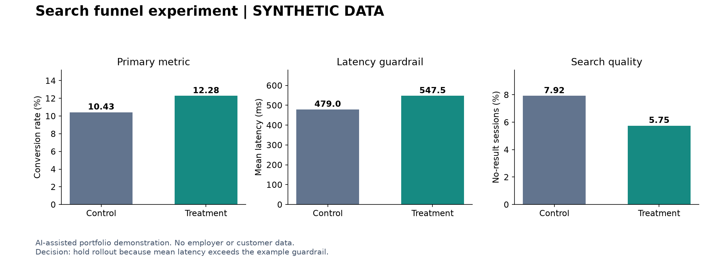

# Search funnel experiment: a product analytics case study

**Synthetic demonstration created with AI assistance. This is not Microsoft, Bing, customer, or employer data, and the findings are not claimed business achievements.**

## Decision

Evaluate a hypothetical search-results change using conversion as the primary metric and latency as a guardrail. For this example, the rollout rule is: the 95% conversion-effect interval must exclude zero and the mean-latency increase must stay below 50 ms. The rule is a stated decision criterion, not a claim of experiment preregistration.

## Data and method

- 12,000 generated users, one session per user; fixed seed 20261029.
- Approximately 50/50 random assignment, with assignment preceding generated outcomes.
- A session can convert only after a result click; sessions with no results cannot click.
- Independent SQL and Python calculations verify conversion counts.
- Unpooled normal-approximation 95% confidence interval for the difference in proportions; pooled two-sided z-test. This demonstration has sufficient counts for the approximation. One primary metric; subgroup results are exploratory.
- Sample-ratio check p-value: 0.756.

## Results

| Metric | Control | Treatment |
| --- | ---: | ---: |
| Sessions | 5,983 | 6,017 |
| Conversions | 624 | 739 |
| Conversion rate | 10.43% | 12.28% |
| Mean latency (ms) | 479.0 | 547.5 |

Absolute conversion effect: **+1.85 percentage points**, with a 95% interval of **[+0.72, +2.99] percentage points**. Relative lift: +17.8%. Two-sided p-value: 0.0014. Mean latency increases by **68.5 ms**.

## Recommendation

**Hold the rollout under the stated guardrail.** Even if conversion improves, the latency increase exceeds the example's 50 ms threshold. Profile the added search step, optimize it, and rerun a controlled experiment. Report both the primary metric and the guardrail rather than presenting the conversion lift alone.

## Limitations

The generator intentionally creates different click rates and latencies, so these effects demonstrate analysis, not discovery about real customers. Sessions are independent by construction; real experiments need user-level assignment, repeat-user handling, exposure checks, bot exclusion, seasonality controls, and a prospective sample-size plan. No claim is made that this one simulated run generalizes to a production system.

## Reproduce

Run `python analysis.py` with Python 3.10+; it uses only the standard library and regenerates the data, SQL, results, and this report from a fixed seed. `analysis.sql` runs against the included CSV loaded into a SQLite `sessions` table. Open `analysis.ipynb` for a short notebook walkthrough.

## Files

- `analysis.py`: data generation, SQLite queries, inference, and consistency checks.
- `analysis.sql`: primary metrics, device segmentation, and funnel queries.
- `sessions.csv`: synthetic session records generated locally by `analysis.py` (not committed).
- `results.json`: complete calculated results and validation checks.
- `analysis.ipynb`: executable notebook walkthrough.

Prepared for Rahul Kashyap's portfolio, October 2026.
